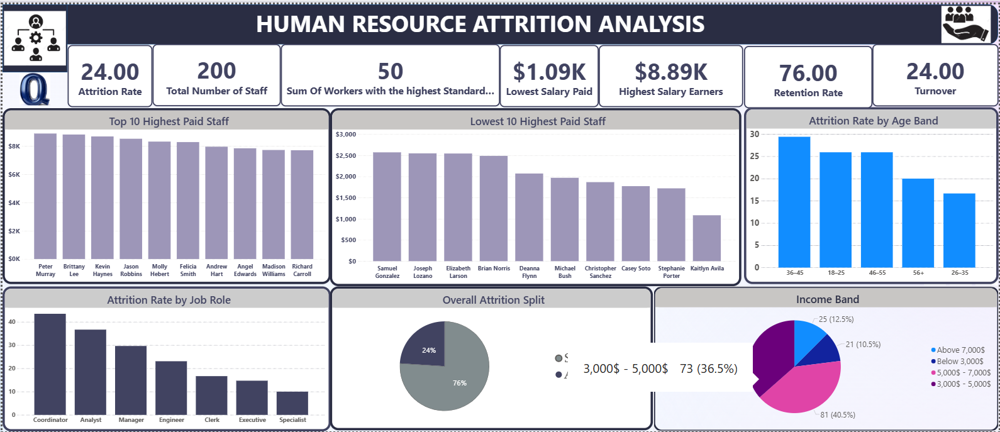
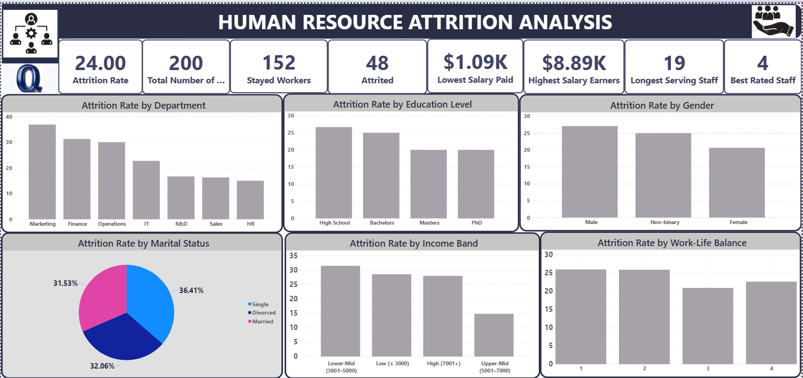

# Employee Attrition Analysis (Power BI) — Qurate Analytics

> A Power BI HR analytics project that looks at attrition across 200 employees and finds the departments, roles, pay bands and demographic groups where people leave most often.

## Business Problem
The company has a relatively high attrition rate, and that hurts performance and day-to-day operations. Employees are leaving from many departments, but HR doesn't know what is driving it. This project looks at attrition by department, job role, income level, job satisfaction, work-life balance and demographics. The goal is to find the main drivers and give HR insights it can use to build retention strategies.

## Dataset
- **Source:** Employee dataset provided by the HR Department (per the project report)
- **Size:** 200 records × 16 columns
- **Key fields:** Attrition, Department, Job Role, Monthly Income, Years at Company, Work-Life Balance, Job Satisfaction, Overtime
- **Timeframe:** Point-in-time snapshot (no time sequence)
- The raw data file is not in this repo. It is held inside the Power BI data model (`QURATE ANALYTICS.pbix`).

## Tools Used
- **Microsoft Power BI**: data cleaning, DAX measures, data modelling and dashboards
- **Microsoft Word**: written project report

## Approach
1. **Data cleaning and preprocessing:** standardized column names, converted Attrition to binary (Yes = 1, No = 0), and checked that there were no missing values or duplicates. Inconsistencies were corrected.
2. **Feature engineering:** added an **Income Band** column and an **Age Band** column (18–25, 26–35, 36–45, 46–55, 56+).
3. **Measures:** wrote DAX measures for the KPIs: attrition rate, retention rate, attrited vs. stayed headcount, and min/max salary.
4. **Exploratory analysis:** attrition rate by department, job role, age band, salary band, work-life balance, marital status, gender and education level.
5. **Visualization:** built a KPI dashboard and an attrition-analysis dashboard in Power BI.

## Dashboards
| KPI Dashboard | Attrition Analysis |
|---|---|
|  |  |

## Key Findings
*All figures come from the project report (`Akai Anointed Attrition Data.docx`).*

- **Overall:** 200 employees. **48 left (24% attrition)** and 152 stayed (76% retention). Monthly salary ranges from $1.09K to $8.89K.
- **Departments:** **Marketing has the highest attrition at 36.84%**, followed by Finance (31.25%) and Operations (30.0%).
- **Job roles:** the roles most likely to leave are **Coordinators (43.48%)**, Analysts (36.67%) and Managers (29.63%).
- **Compensation:** the lowest income band ($3,000–$5,000) has **31.51% attrition**, which points to pay as a retention driver.
- **Work-life balance:** employees who rated work-life balance low have higher attrition: 26.0% at rating 1 and 25.93% at rating 2.
- **Age:** attrition is highest at **36–45 (29.41%)** and lowest at 26–35 (16.67%).
- **Marital status:** single employees have the highest attrition (36.41%).
- **Gender:** male attrition is 27.08% and non-binary attrition is 25.00%.
- **Education:** school leavers are the most likely to leave (26.67%).

## Recommendations
- **Targeted retention:** focus first on Marketing, Finance and Operations.
- **Role redesign:** adjust workload for Coordinator and Analyst roles.
- **Compensation:** benchmark lowest-band salaries against market rates and add retention incentives for critical roles.
- **Work-life balance:** introduce flexible scheduling, enforce overtime limits, and give managers recognition and engagement toolkits.
- **Engagement:** run structured 30/60/90-day onboarding and hold stay interviews with employees in their first year.
- **Workforce planning:** look closely at retention risk in the 36–45 age group, single employees and school-leaver hires.

## Repository Structure
```
QUARATE-ATTRITION-ANALYSIS/
├── QURATE ANALYTICS.pbix               # Power BI report & data model
├── Akai Anointed Attrition Data.docx   # Full project report (methodology, insights, recommendations)
├── images/                             # Dashboard screenshots
└── README.md
```

## How to Run
1. Clone the repo: `git clone https://github.com/OfficialAKAIANOINTED/QUARATE-ATTRITION-ANALYSIS.git`
2. Open `QURATE ANALYTICS.pbix` in **Power BI Desktop** (free, Windows).
3. Open `Akai Anointed Attrition Data.docx` to read the full written report.

## Author
**Anointed Ubongabasi Akai**, Data Science
[LinkedIn](https://www.linkedin.com/in/akaianointed) · [GitHub](https://github.com/OfficialAKAIANOINTED)
